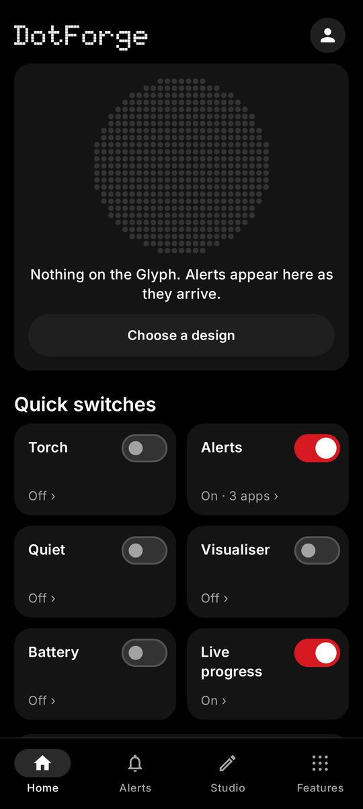
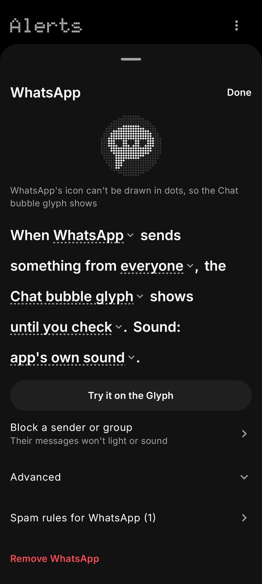
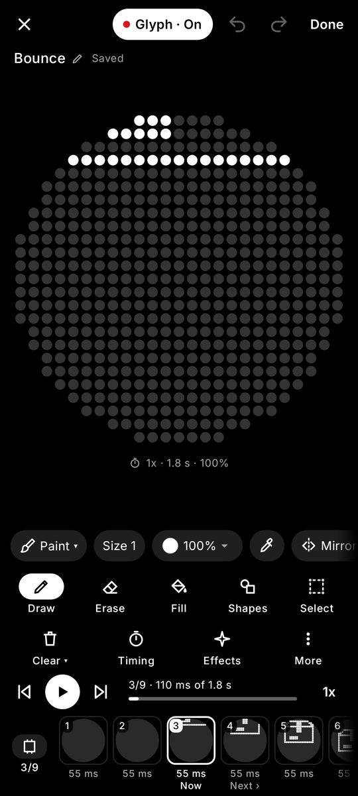

# DotForge

DotForge is an Android app for the Nothing Phone (3) Glyph Matrix: the 25 by 25 grid of round dots on the back of the phone. It lights the Glyph for your apps, people and calls, lets you draw your own glyphs and animations, and keeps spam calls and messages out. Package `com.dotforge`.

**New here? Read the [User guide](docs/USER_GUIDE.md).** It explains every screen and feature step by step, in plain words.

<p align="center">
  
  
  
</p>

## What it does

The app has four tabs: **Home**, **Alerts**, **Studio** and **Features**. Settings and backup are in Profile (the round icon on Home).

- **Home**: a live copy of the Glyph with a Stop button, six quick switches (Torch, Alerts, Quiet, Visualiser, Battery, Live progress), a setup checklist, the always-on face and a home screen widget.
- **Alerts**: one sheet for every app and person that reads as a sentence ("When WhatsApp sends something from everyone, the Chat bubble glyph shows until you check"). Phone calls with the caller's name scrolling on the Glyph, reminders and to-dos, phone moments, quiet time, and a History of what lit and what was skipped.
- **Spam blocking** for calls, SMS, WhatsApp and any other app: block rules (starts with, ends with, contains, exactly, words), contacts and repeat callers always let through, a community spam list, and a spam log. A full filter builder (sender, title, text, number, All / Any / Not, named lists) is available for advanced rules.
- **Studio**: a pixel editor with draw, erase, fill, shapes, select, mirror, effects and a layer model (background, text, drawing). Animations with frames and onion skin. Photo to dots (13 styles, adjustments, face crop, several photos or a GIF or video to frames). Text animations (17 styles, six directions). Glyph ringtones made from a song, with a timeline editor.
- **Library**: hundreds of original glyphs, animations, words and glyph + text designs, with categories, search, favourites and recent items.
- **One timing panel** everywhere: Show for, Speed, Repeat and Brightness.
- **Features**: timer and stopwatch (six timer styles), Live progress for deliveries and rides (Zomato, Swiggy, Blinkit, Uber, Ola, Rapido, Amazon and more), 17 Glyph Toys and more from other makers, music visualiser, torch, battery and volume lights, and integrations for Tasker and other apps.
- **Profile**: permissions, backup and restore, widget, help.

Everything runs on the phone. No account, no ads, no tracking. The only data sent anywhere is the place for the Weather toy, which goes to Open-Meteo. Details are in the [privacy section of the guide](docs/USER_GUIDE.md#12-privacy).

## Automation API

Broadcasts to `com.dotforge/.automation.AutomationReceiver`, which requires the normal-level permission
`com.dotforge.permission.AUTOMATE` (the sender declares `<uses-permission>`). DotForge obeys only apps the
user allowed on the Features > Integrations page; an app shows there, under Apps you allow, after its first command. The sender is the package
Android reports (Android 14+, when the sender shares its identity with `BroadcastOptions`), otherwise the
creator of a PendingIntent the sender puts in the extra `caller`; a broadcast with neither is ignored.

| Action | Extras |
| --- | --- |
| `com.dotforge.action.PLAY_COMPOSITION` | `composition`: a saved composition's title or content URI (sound at media volume, lights at 30 fps) |
| `com.dotforge.action.SHOW_GLYPH` | `glyph`: a style (Pulse, Ring chase, Flash, Sparkle, Comet, ...) or a saved design's name, or `text` (up to 64 letters, scrolls); `seconds` 1-60, default 5 |
| `com.dotforge.action.VISUALISER` | `on`: true / false |
| `com.dotforge.action.SET_RULE` | `rule`: a rule's name or id; `on`: true / false |

Booleans and numbers may be strings ("on", "off", "1", "10"). Starting the visualiser from the background can
be refused by Android (microphone foreground-service rules); the result line on the Features > Integrations page says so.

## Modules

| Module | Contents |
| --- | --- |
| `:core-device` | Pure Kotlin/JVM. `DeviceProfile` (25x25 grid, round mask `(x-12)^2 + (y-12)^2 <= 153` = 489 LEDs, 68-cell outer ring clockwise from 12 o'clock, 625 <-> 489 helpers), `Frame` / `Animation`, `Effects` (pulse, ring chase, flash, sender letter, marquee, sparkle, progress ring, dice, clock, checkerboard, spam, call blocked / silenced, missed call), the 5x5 `PixelFont` / `DotText` and 3x5 `BigDigits`, and the Dot Hub / Glyph Museum JSON model (`GlyphMuseumJson`). |
| `:glyph-driver` | `GlyphDriver`: the only code that touches Nothing's `GlyphMatrixManager`. Process-wide, ref-counted, one IO thread, newest-frame-wins per channel (app / toy), reconnect with backoff, `StateFlow` state, fps and call log. Frames are 0-255; the driver rescales to the SDK's raw 0-4095 range. |
| `:composition` | Pure Kotlin/JVM. Ogg page reader/writer and CRC check, Vorbis comment / OpusTags parser, glyph `AUTHOR` codec (base64 -> zlib -> CSV, plus Composer-style output), `OggRepager` (rewrites the comment header of an Ogg Opus / Vorbis file: keeps the identification page, re-pages the comments, renumbers later pages and recomputes CRCs), `GlyphRingtone` writer, `RingtoneConverter` (other phones' zones to the matrix), own FFT, `AudioAnalyzer` (60 fps band energies and spectral-flux onsets) and `AutoComposer`, `SongWindow` / `PeakEnvelope`, the editable `Timeline` (lanes of keys, `TimelineRenderer`, CUSTOM1 `TimelineCodec`), and the visualiser's `SpectrumBands`, `LiveLevels` and `VisualiserRenderer`. |
| `:app` | Compose + Material 3 UI (Home, Alerts, Studio and Features tabs, the editor, Profile, Diagnostics), ringtone import (MediaCodec decode, Opus encode, MediaMuxer OGG), MediaStore library and Set as, timeline editor, Get more catalog (GitHub contents API), music visualiser engine (Visualizer / microphone), Live service and tile, `DisplayArbiter` and the notification `AlertQueue` / `AlertPlayer`, filter engine (`filter/`: fields, operators, named lists, sender extraction), rules engine, filters and notification listener, call screening service, phone number normaliser, spam list store and weekly worker, caller glyphs, designs store, toys, torch tile. |

### Who owns the matrix

- Toys draw on the toy channel (`setMatrixFrame`) through `GlyphDriver`.
- Everything else goes through `DisplayArbiter` -> `MatrixDevice` -> `GlyphDriver` on the app channel
  (`setAppMatrixFrame`). `MatrixDevice` is a thin adapter; on non-Nothing phones it is a preview-only
  device and the matrix is just drawn in the app.
- Arbiter priority: torch (70) > Studio preview (60) > notification (50) > progress (30); newest wins on ties.
  Diagnostics suspends the arbiter while it drives the driver directly.
- Notifications reach the arbiter through one alert at a time: `Delivery` turns the notification into a
  filter `Subject` (sender from MessagingStyle messages, the title, the conversation title or the people URIs;
  number normalised to E.164; email from a mailto: person), then `RuleEngine.decide` runs the allow and
  blocking rules first (the most specific decides; allow wins a tie), then the most specific rule that shows
  (exact sender > person > app and words > words > app > caller flags > anything, then manual priority, rules
  limited by time first, then list order), then quiet hours, Do Not Disturb, locked and face down. Calls take
  the same path from `GlyphCallScreeningService` (contacts, the spam list and the phone's state are read only
  when a condition needs them). `AlertQueue` puts ringing calls first,
  keeps at most six waiting, never cuts an alert mid-animation (it switches at the end of a cycle), ignores
  re-posts of a conversation for 10 s, and keeps "until read" alerts looping until the notification is
  removed or the phone is unlocked ("until unlock" survives removal; "timeout" shows for about 6 s).
- Firmware lights always win over app frames (ringtone > active toy > Nothing notification glyph > app
  frames) and the app is never told when it was covered, so the arbiter re-sends the current frame every
  3 s, immediately on screen-on / unlock and again 1.5 s later, and 1.5 s after a notification we show
  (when Nothing's own notification glyph has finished).
- Notifications and progress ("ambient" requests) follow Nothing's `led_effect_enable` switch and the Glyph
  bedtime schedule (`led_effect_schedule_time_ebable`, `led_bed_time_custom_*`; switchable with Quiet hours >
  Follow Nothing bedtime) when the firmware lets apps read them; unreadable settings never block anything.
  Torch and the Studio preview always work.
- Saved data: `rules.json` (`{"version":3,"rules":[…],"lists":[…]}`), `filters.json` (spam alert, Spam log,
  quiet hours and switches; replaces `spam.json`), `calls.json` (call options, recent calls for repeated
  callers, caller glyphs), `spam-list/` (the downloaded list, its ETag and version), `designs.json`.
  Version 1 rules (a bare array) and version 2 rules (apps / people / keywords slots) are migrated once into
  filter-engine rules without losing a setting; the version 2 spam filter's words, patterns, unknown senders
  and allowed senders become the spam rules and the Spam words / Allowed senders lists. The project has no
  database, so this is a JSON migration with tests rather than a Room migration.
- The spam list is CallShield's `data/spam_numbers.txt` from GitHub (MIT; US FCC / FTC complaint data and
  community reports; no key or paid API): fetched by WorkManager when a rule first uses it, then weekly on any
  network, with ETag, a 16 MB cap and a sanity check; kept as a sorted array for binary search.

## Build

Requirements: JDK 17+, Android SDK platform 36 (set `ANDROID_HOME` or `sdk.dir` in `local.properties`).

```
./scripts/fetch-glyph-sdk.sh      # downloads Nothing's AAR into app/libs/ (not redistributable, gitignored)
./gradlew test assembleDebug
```

APK: `app/build/outputs/apk/debug/app-debug.apk`. CI (`.github/workflows/android.yml`) runs the same.

Unit tests cover the device geometry and effects, the JSON model, the Ogg/AUTHOR codec, the Ogg re-pager (page
layout, renumbering, CRCs, audio packets and granules unchanged, Vorbis setup sharing a page, audio on a header
page), the ringtone writer (read back with identical AUTHOR, Composer-style CSV and base64, empty-zlib CUSTOM1),
the converter per layout and column count, the analyser and composer (onsets on a synthetic signal,
determinism, silence, Intensity / Speed, the LED mask), the song window (limits, loudest part, moves and
resizes, envelope), the timeline (key shapes, regions, render to AUTHOR, imported lane trim and scale, CUSTOM1
round trip through the writer and parser, other apps' CUSTOM1 ignored) and its editor state (undo), the
visualiser band mapping (band edges, a sine lights its band, Visualizer FFT bytes, levels, frames inside the
mask), the Get more catalog (licence filter, contents parsing, rate limits, cache), the rules engine
(scope per source, specificity and priority, spam before showing, the default spam rules, spam prefixes,
call rules, explanations, lazy contact lookups), the filter engine (every operator, number normalisation in
starts / ends / contains / is, named lists, All / Any / Not, nested groups, flags, time ranges across
midnight, days, descriptions), sender extraction (SMS, WhatsApp direct and group, Gmail-style), phone number
normalisation (E.164 and prefixes), the spam list parser, the repeated-caller window, rules persistence and
the version 1 and 2 migrations (including the old spam settings), named lists, the Spam log and spam.json
migration, call settings and caller glyphs, quiet hours across midnight and the filter order, the alert queue (calls first, bound, no cut
mid-cycle, cooldown, hold until read / unlock, timeout) and its player, the rule sentence text, the designs
store, the notification-access flow, the arbiter (priority, fallback, timeouts, master switch, gate, re-send,
delayed re-send), the Glyph Button press decoder, the 12-hour clock and the bedtime schedule.


## Licences

- The Nothing Glyph Matrix SDK AAR is **not** included and must not be committed or redistributed (its EULA
  forbids it). `scripts/fetch-glyph-sdk.sh` downloads it from Nothing's public repository.
- Code adapted from MIT- and Apache-2.0-licensed projects is listed in `NOTICE` (Apache licence text in
  `licenses/`).
- Nothing setting key names and formats come from inspecting Phone (3) firmware behaviour; no Nothing code is included.
- The Tasker / Locale plugin is written from Locale's public plugin documentation (the EDIT_SETTING /
  FIRE_SETTING intents and their extras); no plugin library code is used.
- Toys on the Toys page are other people's apps, linked from their GitHub Releases at run time, not bundled.
