# DotForge user guide

DotForge turns the back of your Nothing Phone (3) into something useful and fun. It lights the Glyph Matrix (the 25 by 25 dots on the back) when apps, calls and people get in touch. It also lets you draw your own pictures and animations, turn photos into dots, show a timer or a delivery on the back, and keep spam out.

This guide explains every part of the app in plain words. You do not need to know anything technical.

  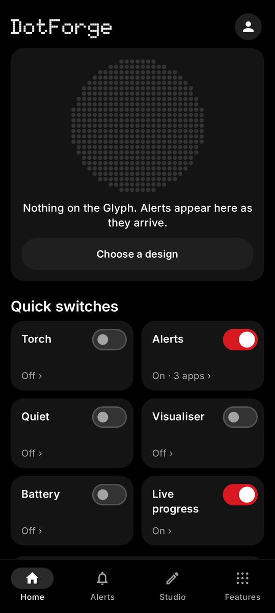

## Contents

1. [What you need](#1-what-you-need)
2. [First run](#2-first-run)
3. [The four tabs and your Profile](#3-the-four-tabs-and-your-profile)
4. [Home](#4-home)
5. [Alerts](#5-alerts)
6. [Studio and the editor](#6-studio-and-the-editor)
7. [Library](#7-library)
8. [The "On the Glyph" controls](#8-the-on-the-glyph-controls)
9. [Features](#9-features)
10. [Settings, permissions, backup and restore](#10-settings-permissions-backup-and-restore)
11. [Troubleshooting and FAQ](#11-troubleshooting-and-faq)
12. [Privacy](#12-privacy)

---

## 1. What you need

- A **Nothing Phone (3)**, with Android 16.
- The DotForge app installed.

DotForge can be opened on other phones. You can still draw designs and set up spam blocking there, and the previews play on the screen. But the real lights only work on a Phone (3). On any other phone the app says "Needs Phone (3)".

A few words used in this guide:

- **Glyph** or **Glyph Matrix**: the dots on the back of the phone.
- **Design**: a picture, animation or text that you made or picked, shown as dots.
- **Toy**: a small thing that lives on the Glyph, like a clock or a game. You switch between toys with the Glyph Button on the back of the phone.
- **Sheet**: a panel that slides up from the bottom of the screen.

---

## 2. First run

The first time you open DotForge, a short set-up walks you through it. It takes about a minute. You can tap **Skip setup** at the top right at any time, and tap the back arrow to go back a step. Small dots at the top show which step you are on.

  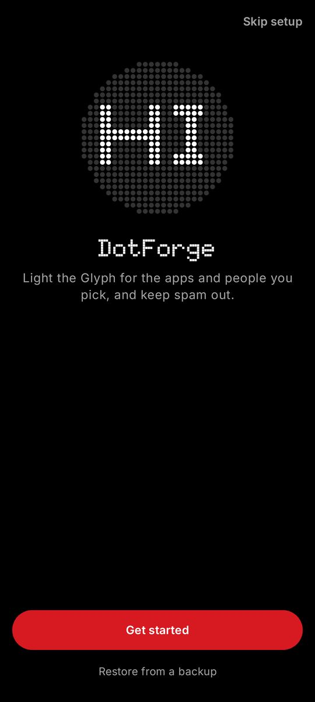
  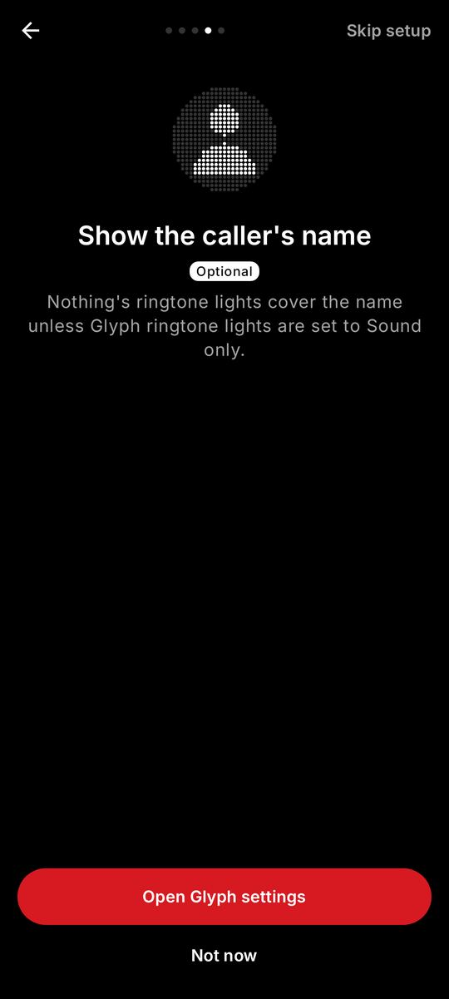
  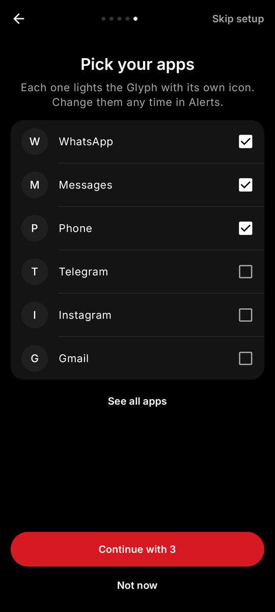

<em>The welcome screen, the caller name step and the app list.</em>

### The welcome screen

You see the word HI on the dots, and the name DotForge.

- Tap **Get started** to begin.
- If you saved a backup before, tap **Restore from a backup** instead. If a backup file is waiting in your Downloads folder, the link says so.

### The permission steps

Every step explains why it is needed. Tap **Allow** to open the Android screen for it, or **Not now** to skip it. Nothing breaks if you skip. The part of the app that needs it will ask again later, right when you use it.

| Step | What it is for |
|---|---|
| **Notification access** | The main one. It lets DotForge see that a notification arrived so it can light the Glyph. It also lets DotForge read the caller's name from caller ID apps, and the progress of deliveries and downloads. |
| **Calls** | Lets DotForge block spam calls and show who is calling, using your contacts. Android asks twice: once to let DotForge screen calls, then for your contacts. |
| **Keep running** | Lets DotForge keep working when the screen is off, so the Glyph still lights up. |
| **Show the caller's name** (optional) | A tip about ringtone lights. See below. |

If you installed DotForge from a file instead of a store, Android may say it **blocked access** to notifications. DotForge then shows three steps: tap **Open App info**, tap the three dots at the top right and choose **Allow restricted settings**, then come back and tap **Try again**.

### The "Sound only" tip for caller names

When someone calls, DotForge can scroll their name across the Glyph. But Nothing has its own ringtone lights, and they cover DotForge's lights while the phone rings. To see the name, set Nothing's ringtone lights to **Sound only**:

1. On the **Show the caller's name** step, tap **Open Glyph settings**. (If your phone cannot open that page directly, the button says **Open Settings** instead.)
2. Find the Glyph ringtone lights setting and choose **Sound only**.
3. Come back to DotForge. The step shows **Done**.

This step is optional. You can do it later from the Phone calls row in Alerts.

### Pick your apps

The **Pick your apps** step lists apps like WhatsApp, Messages and Phone, already ticked. Each ticked app will light the Glyph with its own glyph.

1. Tick the apps you care about. Untick any you do not want.
2. Tap **See all apps** if yours is not listed.
3. Tap **Continue** (it shows **Continue with 3** if you picked three).

You can change this at any time in the Alerts tab.

### You're set

The last screen says **You're set**. Tap **Go to Home**. On a Phone (3) the Glyph plays a hello animation.

If some permissions are still missing, Home shows a small banner, for example "2 things need permission", with a **Fix** button. See [Home](#4-home).

---

## 3. The four tabs and Profile

The bar at the bottom of the screen has four tabs:

| Tab | What it is for |
|---|---|
| **Home** | See what the Glyph is doing right now, and use quick switches. |
| **Alerts** | Choose what lights up, and what gets blocked. |
| **Studio** | Make your own glyphs, animations, text and ringtones. |
| **Features** | Everything else: timers, live progress, toys, the music visualiser, the torch, battery lights, integrations. |

Tips:

- Tap the tab you are already on to scroll back to the top.
- The back button on any tab takes you to Home. Back on Home leaves the app.

**Profile** opens from the round person icon at the top right of Home. It holds settings, help, backup and information about the app. See [Settings](#10-settings-permissions-backup-and-restore).

---

## 4. Home

  
  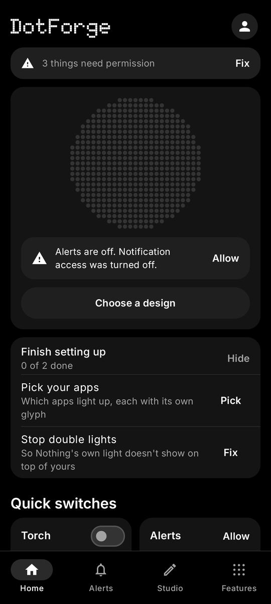

<em>Home, and Home when something still needs a permission.</em>

### What it does

Home is the page that tells you what is going on. At the top you see **DotForge** in dot letters, and the Profile icon.

- **The live preview.** A big picture of the Glyph that copies the real one. Under it, one line says what is showing, for example "Showing: WhatsApp from Mom". When nothing is showing it says "Nothing on the Glyph. Alerts appear here as they arrive."
- **Stop.** When something is showing, a red **Stop** button appears. It stops that light. Your notification stays. If more alerts are waiting, the button says **Stop all**.
- **Choose a design.** Tap it to pick a design and see it on the Glyph.
- **Quick switches.** Six tiles, each with a name, a status line and a switch (see below).
- **A spam line.** For example "3 spam calls blocked this week". Tap it to see what was blocked.
- **Always-on.** Shows which face the Glyph uses when the screen is off (for example "Always-on: Clock"), with a **Change** button.
- **Recent designs.** Small pictures of designs you used lately. Tap one to try it.

### The quick switches

| Tile | What the switch does |
|---|---|
| **Torch** | Turns the whole Glyph into a light. It shows the time left. |
| **Alerts** | Pauses or resumes all app alerts. When paused it says "Paused · calls still light". |
| **Quiet** | Turns quiet time on or off. It shows until when. |
| **Visualiser** | Starts the music visualiser. |
| **Battery** | Shows the battery on the Glyph when you plug in. |
| **Live progress** | Shows deliveries, rides and downloads as a ring. |

Tap the tile itself (not the switch) to open that feature's page. If a tile needs a permission it shows an **Allow** button instead of a switch, for example "Needs microphone" for the Visualiser.

### The permission banner and the checklist

- At the top, a banner such as **3 things need permission** with a **Fix** button shows when something is missing. Tap **Fix** to see which permissions.
- A card called **Finish setting up** lists what is left, for example **Pick your apps** (button **Pick**) and **Stop double lights** (button **Fix**). Tap **Hide** to hide it. It disappears by itself when everything is done.
- If notification access gets turned off, the preview shows "Alerts are off. Notification access was turned off." with an **Allow** button.

### Other messages you may see

- **Update Nothing OS to use the Glyph**: the phone's software is too old for the Glyph to be used.
- **The Glyph is off in Settings**: tap **Open Glyph settings** to switch it on.
- **The Glyph is busy**: something else, for example Nothing's own light, is using the Glyph. Yours shows when it ends.

### Home screen widget

You can put a Glyph widget on your phone's home screen. It shows either the live Glyph or one design, and a tap opens DotForge or moves to your next favourite.

1. Tap the Profile icon, then **Home screen widget**. (You can also use **Features > Toys > Add the widget**.)
2. Follow Android's prompt to place it. If nothing appears, touch and hold your home screen, tap **Widgets**, and find DotForge.
3. In the widget's settings, under **Show**, pick **Live Glyph** or a design. Under **Tap**, pick **Open DotForge** or **Next favourite**. Then tap **Add widget**.

---

## 5. Alerts

  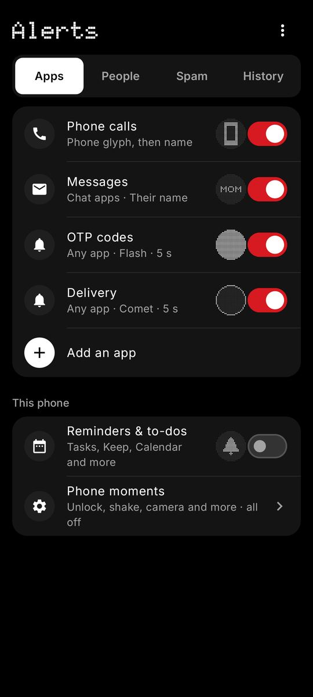
  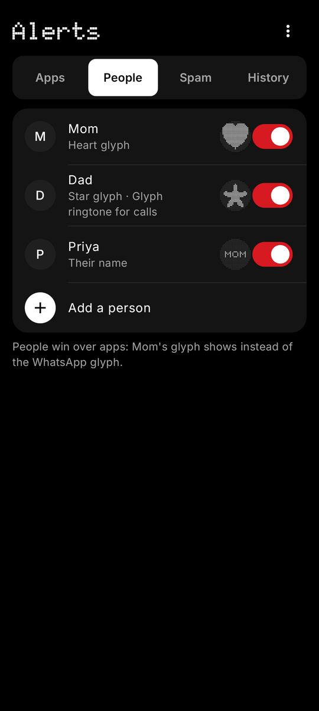

### What it does

Alerts is where you decide what lights the Glyph. At the top there are four parts: **Apps**, **People**, **Spam** and **History**. The three dots at the top right open **Alert settings**, **How it works** and **Clear history**.

The order of importance is simple: calls come first, then people, then apps.

### Apps

The Apps list shows one row for each app (or kind of alert) that lights the Glyph. Each row has the app's name, a short summary like "Everyone · Chat · Stays on", a small preview of its glyph, and a switch.

Some rows are built in:

- **Phone calls**: the glyph and the caller's name for incoming calls.
- **Messages**: chat and SMS apps.
- **OTP codes** and **Delivery**: pre-made rows for codes and delivery messages from any app.
- Under **This phone**: **Reminders & to-dos** and **Phone moments**.

#### Add an app

1. Tap **Add an app** at the bottom of the list.
2. Search for the app by name. Apps that sent you notifications this week are listed first.
3. Tap the app. It is added and its sheet opens so you can pick its glyph.

To take an app away, open its row and tap **Remove [app name]** at the bottom. A bar appears with **Undo** for a few seconds.

### The one rule sheet

Tap any app or person and a sheet opens. It is the same sheet for everything. At the top is a preview of the glyph, then a sentence you can change by tapping the underlined words:

> When **WhatsApp** sends something from **everyone**, the **Chat bubble glyph** shows **until you check**. Sound: **app's own sound**.

  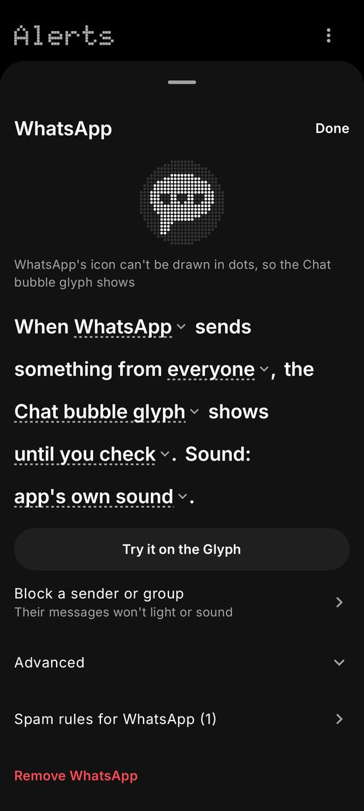

How to use it:

1. Tap the underlined **glyph** name. Pick from **Library** (ready-made glyphs) or **Yours** (your own designs). Two special choices are **App icon** and **Their name**. Tap **Done**.
2. Tap **everyone** to choose **Everyone** or **Only people I pick** (apps only).
3. Tap **until you check** to choose how long it shows: **5 s**, **10 s**, **30 s** or **Until you check**. With "Until you check" you can also set **Remind me**: **Off**, **Every 1 min**, **5 min** or **15 min**.
4. Tap **app's own sound** to choose the sound: **App's own sound**, **No sound** (the app's notification is silenced and a quiet copy stays in your notification list), or **Custom tune**.
5. Tap **Try it on the Glyph** to see it on the real Glyph.

"Until you check" means the glyph stays on until you open or dismiss that notification (even if you read it on WhatsApp Web), open the app, or tap **Stop** on Home.

Below the sentence you will find:

- **Block a sender or group**: stops one person or group in this app from lighting or sounding. See [Spam](#spam).
- **Advanced**: tap to open more options (see next).
- **Spam rules for [app]**: the spam rules that cover this app.
- **Remove [app]**.

#### Advanced options in the sheet

| Option | What it does |
|---|---|
| **Words** | Light only when the message contains one of the words you list. |
| **Only these chats** | Light only for the chats or groups you name, exactly as the app shows them. |
| **Times** | Light only on chosen days and between chosen hours. |
| **Brightness** | How bright the glyph is. |
| **Speed** | How fast it moves. |
| **Remind me** | Shows again after a rest until you check. |
| **One alert per chat per minute** | Stops a busy chat from lighting over and over. |
| **Include group chats** | (People only) Also light when this person writes in a group. |
| **Who wins** | Opens the order of people and apps. Use the arrows to move one up or down. |

  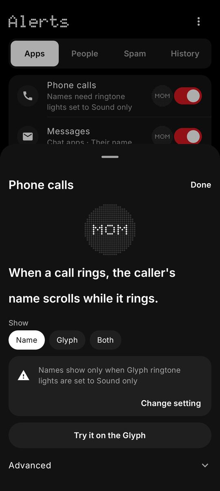

### The filter for any app (sender, title, text, number)

Words and Only these chats cover most needs. For full control there is a more powerful rule editor. It can match any app by:

- **sender**, **phone number**, **sender email**, or whether the sender is **in Contacts** or **starred**;
- **title or text**, **title**, **text**, **long text**, **subtext**, **summary**;
- the **app**, the **notification channel**, the **category**, whether it is a **group chat** or **ongoing**;
- for calls: **calling again**, **hidden number**, **caller ID check** and **spam list**;
- **time**, **day**, **phone locked**, **Do Not Disturb**, **charging** and **quiet hours**.

For each one you choose how to compare: **is**, **is not**, **starts with**, **ends with**, **contains**, **does not contain**, **is in list** (a named list you made), and under **More**, **matches regex** and **Not**. Comparing ignores capital letters. Phone numbers are matched in any format, so "+91 98...", "0091 98..." and "098..." count as the same start.

You can join conditions with **All conditions must hold** (AND) or **Any one condition is enough** (OR). Under **Advanced** you can add **Groups**, for example "(sender is A or sender is B)", and set **Priority**. The editor has a **Would match** list that shows recent notifications the rule catches, and a **Try on the matrix** button.

At the end, you choose what happens: show a glyph (with its length, sound and vibration), always allow, silence, hide, or mark as spam. For calls you can also reject.

**Where to find it.** This editor is still in the app but is not on the main screens. To open it:

1. Open **Profile** (the round icon on Home).
2. Scroll to **About** and tap the **DotForge version** row seven times. A **Developer** section appears.
3. Tap **Old screens**, then **Notifications and rules**, then **New rule**.

Rules you make there work together with the simple sheets.

### People

People are the ones who matter. One glyph for a person covers their calls and messages in every app. People win over apps: if Mom writes on WhatsApp, Mom's glyph shows instead of the WhatsApp glyph.

1. Tap the **People** part, then **Add a person**.
2. Search your contacts, or type a **Name** (as apps show it) and an optional **Number**. If Contacts is not allowed, tap **Allow** to pick from them.
3. Tap **Add**. The person's sheet opens.
4. Pick a glyph, how long it shows, and the sound. For calls you can also choose **Their glyph** or **A Glyph ringtone** (a ringtone you made in Studio).

Calls need Call screening to be on. "Their glyph" also needs Nothing's ringtone lights set to **Sound only**.

### The caller's name on the Glyph

When a call rings, the name scrolls across the Glyph. DotForge uses the best name it can find, in this order:

1. Your saved contact name.
2. The name from your phone app's caller ID (for example a business name, or "Suspected spam").
3. The name from another caller ID app such as Truecaller. This also works for WhatsApp and other internet calls.
4. The phone number.

Boring names like "Incoming call" or "Unknown" are ignored. A spam label also shows the Spam glyph.

To set it up:

1. In **Alerts > Apps**, tap **Phone calls**.
2. Next to **Show**, choose **Name**, **Glyph** or **Both** (the default is Both).
3. If you see a note "Names show only when Glyph ringtone lights are set to Sound only", tap **Change setting** and choose **Sound only**.
4. Tap **Try it on the Glyph**.

If the name never shows while the phone rings, see [Troubleshooting](#11-troubleshooting-and-faq).

### Spam

  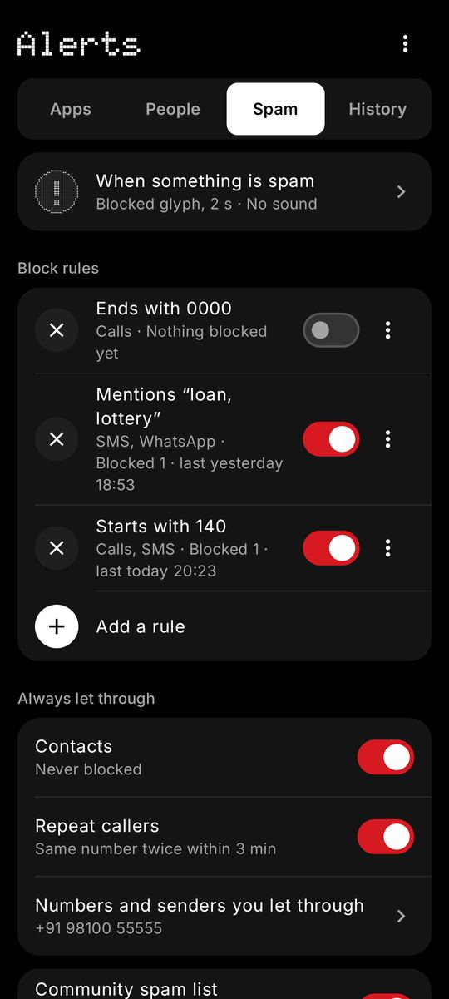
  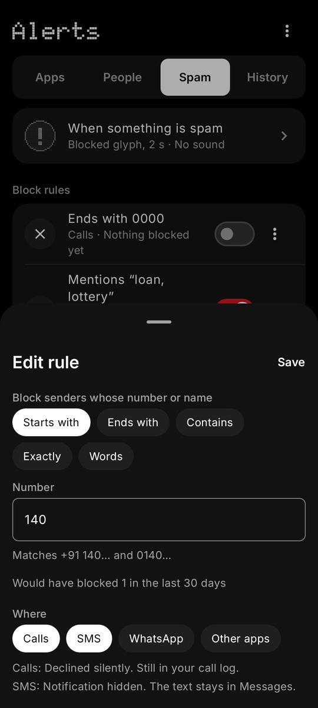

Spam blocking works for phone calls, SMS, WhatsApp and any other app.

What happens when something is blocked:

- **Calls**: declined silently, and still in your call log.
- **SMS**: the notification is hidden. The text stays in your Messages app.
- **WhatsApp and other apps**: the notification is dismissed. The message stays in the app.

DotForge never deletes your messages.

The **Spam** part has:

- **When something is spam**: tap it to choose the glyph (**A short Blocked glyph** or **Nothing**) and the **Sound** for blocked items (the default is **No sound**).
- **Block rules**: your list of rules. Each one has a switch, and a three-dot menu.
- **Always let through**: **Contacts**, **Repeat callers** (the same number twice within 3 minutes), **Numbers and senders you let through**, and the **Community spam list**.

To block numbers that start with 140:

1. Tap **Spam**, then **Add a rule**.
2. Choose how to match: **Starts with**, **Ends with**, **Contains**, **Exactly** or **Words**.
3. Type **140** in the box. The sheet shows what it matches and how many it would have blocked in the last 30 days.
4. Under **Where**, tick **Calls**, **SMS**, **WhatsApp** and/or **Other apps**.
5. Tap **Save**.

To block a single sender in one app, open that app's sheet and tap **Block a sender or group**. Pick someone from **Recent in [app]**, or type a name or number and tap **Block**.

The **Community spam list** is a public list of spam numbers. It is on by default, updates weekly, and the check happens on your phone. Tap **Update now** to refresh it.

If DotForge blocks something by mistake, open **History**, tap the entry, and choose **Not spam**. That always lets them through, and adds them to **Numbers and senders you let through**. The same sheet also offers **Block [name]** for something that lit the Glyph but should not have.

### History

History shows what happened to each alert for 30 days. Use the chips **All**, **Lit**, **Blocked** and **Skipped** to filter. Each line says what happened, for example "Lit · App icon · until you check" or "Skipped · Quiet". If the Glyph did not light and you want to know why, look here. You can also reach it from **Profile > My glyph didn't light**.

  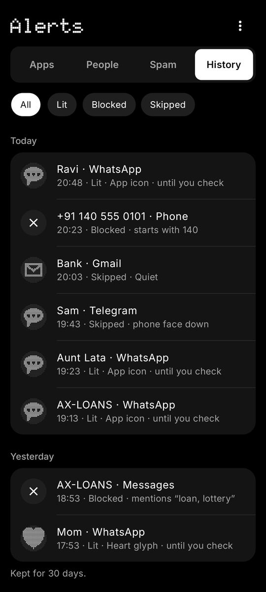

### Reminders and to-dos

Under **This phone** in Apps, **Reminders & to-dos** gives reminder apps their own bell animation. It works for Tasks, Keep, Calendar, To Do, TickTick, Todoist and more.

1. Turn on the switch next to **Reminders & to-dos**.
2. Tap the row. Under **From**, tick the apps it should cover.
3. Optional: tap **Ring before events and alarms** to have the ring fill before the next calendar event or alarm. The times are set in **Features > Live progress** (see [Live progress](#live-progress)).

### Phone moments

**Phone moments** (in Apps, under This phone) lights the Glyph for things you do on the phone. All are off by default. Turn on the ones you want: **Unlock**, **Shake** (two quick shakes), **Camera** (while an app uses the camera), **Alarm or timer** (while one rings) and **Headphones** (when wired or Bluetooth ones connect).

### Quiet time and Alert settings

Open the three dots, then **Alert settings** (or use the **Quiet** tile on Home).

- **Quiet now**: turn on to stop lights.
- **Schedule**: turn on **On a schedule**, then set **From** and **To** and tap the days.
- **Also quiet**: **Follow phone's Do Not Disturb**, **Follow Nothing's bedtime**, **While I'm using the phone**.
- **During Quiet**: **Don't light** or **Dim to 20%**.
- **Let through**: **Favourite contacts** and **Repeat callers**.
- **Light alerts**: **Always**, or **Only when the screen is off**.
- **Until you check**: a switch for "Unlocking counts as checking", and **Stop waiting after** **1 h**, **4 h** or **Never**.

### Two lights at once

Nothing's own notification and ringtone lights can cover DotForge's. On a row you may see "Nothing lights it too · Fix". Tap **Fix** to open Nothing's Glyph settings and set that app to **Sound only**. Home has a matching item, **Stop double lights**.

---

## 6. Studio and the editor

  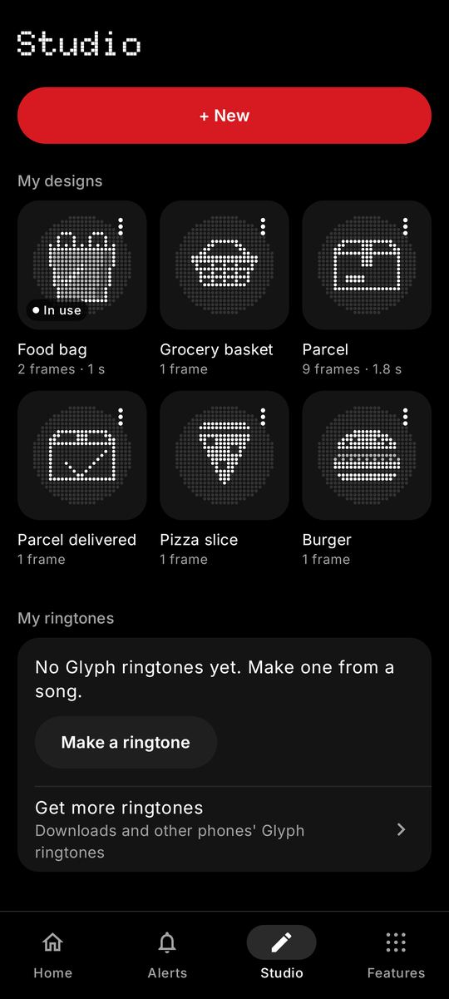
  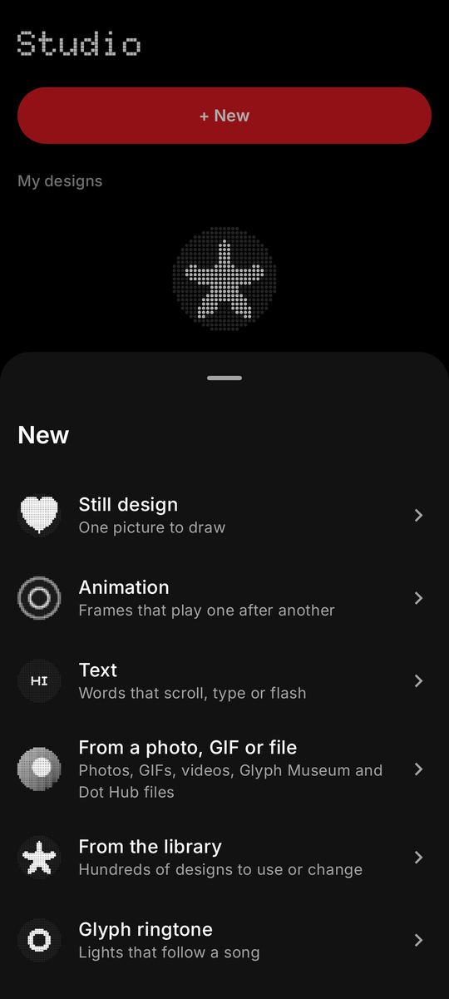

### What Studio does

Studio is your workshop. It has:

- A big red **+ New** button.
- **My designs**: a grid of what you made. Each shows a live preview, its name, and "Still" or the number of frames and length. A small dot with **In use** shows a design that is already used somewhere.
- **My ringtones**: Glyph ringtones you made, with a play button and **Set as**. If you have none, tap **Make a ringtone**. **Get more ringtones** finds downloads and ringtones from other phones.

On a design, tap the three dots (or touch and hold) for: **Use for...**, **Edit**, **Rename**, **Duplicate**, **Share...**, **Delete**. Delete shows **Undo**. Use the search box and **Recent** or **A-Z** to sort when you have many.

### Start something new

Tap **+ New**. Choose one of:

| Choice | What you get |
|---|---|
| **Still design** | One picture to draw. |
| **Animation** | Frames that play one after another. |
| **Text** | Words that scroll, type or flash. |
| **From a photo, GIF or file** | Photos, GIFs, videos, Glyph Museum and Dot Hub files. |
| **From the library** | Hundreds of designs to use or change. |
| **Glyph ringtone** | Lights that follow a song. |

After you tap **Done** in an editor, DotForge asks **Use it for...**: tick where it should show (an app, a person, Phone calls, Reminders, a Phone moment) or choose **Not now**.

### Drawing (the editor)

  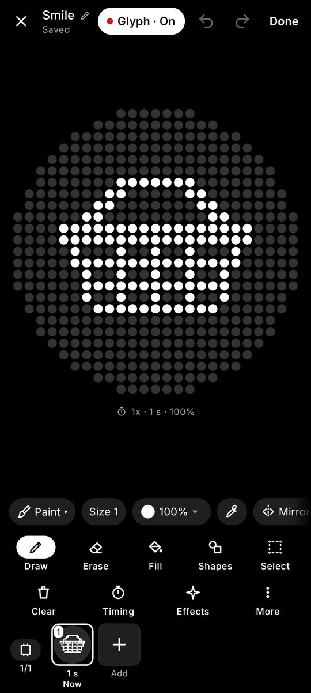

The editor never scrolls. The Glyph fills the middle of the screen. Only touches that start on the dots draw.

**Top bar**: **Close** (the X), the design's **name** (tap to rename), the **Glyph · On** button, **Undo**, **Redo** and **Done**. While **Glyph · On** is on, what you draw shows on the real Glyph at the same time. It lets go of the Glyph when you close the editor.

**Tools** (one row, with labels):

| Tool | What it does |
|---|---|
| **Draw** | Paints dots. Tap the **Paint** pill to switch brush: **Paint** sets dots to the shade, **Brighten** makes lit dots brighter, **Dim** makes them dimmer. **Size** changes the brush. |
| **Erase** | Removes dots. |
| **Fill** | Fills a shape with the shade. |
| **Shapes** | **Line**, **Box**, **Circle**, with a **Filled** option. Drag to make them. |
| **Select** | Pick an area, then **Copy**, **Paste**, **Flip left-right**, **Flip top-bottom**, nudge or **Delete**. |
| **Mirror** | Draws on both sides at once. |

A shade chip shows the brightness of the dot you paint with (for example 100%). Tap it to choose from 8 shades or use the slider. The eyedropper lets you tap a dot on the Glyph to copy its shade.

**Second row**: **Clear**, **Timing**, **Effects**, **More**.

- **Clear** asks you whether to clear this frame, or **Clear all frames** (it keeps the frames). Both have **Undo**.
- **Timing** opens the [On the Glyph controls](#8-the-on-the-glyph-controls).
- **Effects** (see below).
- **More** has **Layers...**, **Trace photo...**, **Insert: a design or photo...**, **Share...**, **Duplicate design**, **How animation works**, **Flatten to frames**, **Delete design**, and **Onion skin** on animations.

Pinch to zoom the Glyph while you draw.

**Effects**: a sheet with **Change it**: **Rotate 90°**, **Flip**, **Invert**, **Shift** (four directions), **Brighter**, **Dimmer**, **Outline**, **Fill in**, **Levels**. Choose **Apply to: This frame** or **All frames**. Under **Replace shade** you can swap one brightness for another. Under **Make it move** you can turn a still frame into moving frames, with **Strength** and **Length** sliders, then tap **Apply**.

**Trace photo**: puts a photo faintly under your grid so you can draw over it. Only you see it.

### Animation: frames

  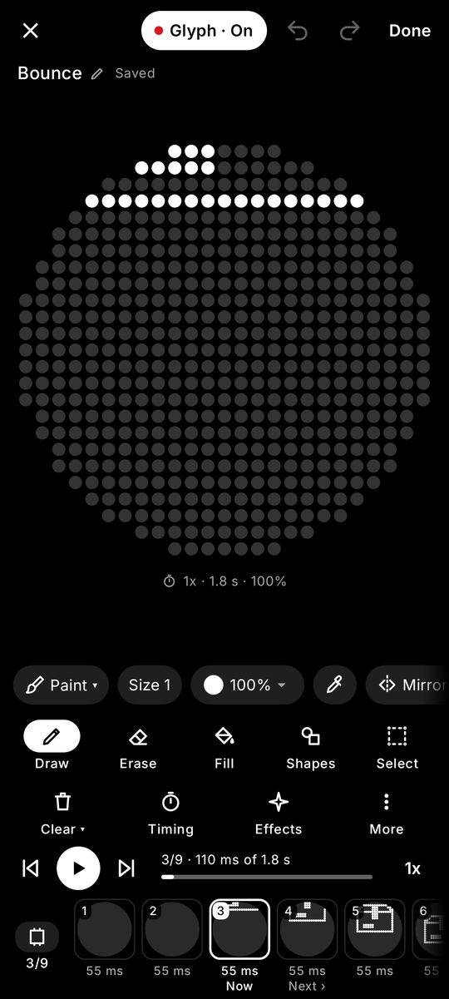

An animation is a row of pictures (frames). When they play in order, they move.

1. Tap **+ New**, then **Animation**.
2. Draw the first picture.
3. Tap the **+** (**Add**) tile in the frame strip. Choose **Copy this frame** or **Blank frame**. (You can also add **Photo as a frame...** or **From the library...**.) A copy is best: change a few dots in each copy and it looks smooth.
4. Draw frame 2, and add more frames the same way. An animation can have up to 300 frames.
5. Tap **Play** to watch it. Use **Step back** and **Step forward** to go one frame at a time, drag the scrubber, and tap the speed button to play at **0.5x**, **1x** or **2x**.
6. Tap **Done**.

Touch and hold a frame to change how long it shows, move it left or right, duplicate it or delete it. **Onion skin** (in **More**) shows the previous frame faintly. The first time, a short guide called **How animation works** plays with three steps. Tap **Skip** or **Next**, then **Start drawing**. You can open it again from **More**.

### Layers: a background plus text

  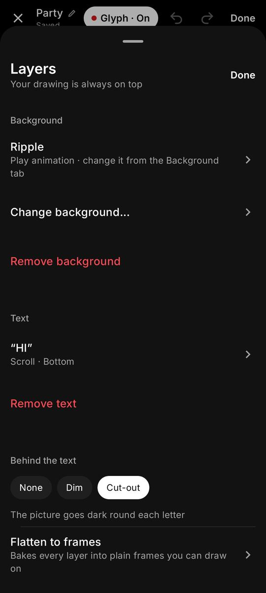

A design can have up to three layers: **Background**, **Text** and **Drawing**. Your drawing is always on top.

1. Open **More > Layers...**.
2. Under **Background**, tap **Add a background**. Pick a library design, one of yours, or a photo.
3. Under **Text**, tap **Add text**. Type the words. Choose a **Text position** (**Full**, **Top**, **Middle**, **Bottom**), a **Style** and a **Font**.
4. Under **Behind the text**, choose **None**, **Dim** or **Cut-out**. Cut-out (the default) makes the picture go dark round each letter so the letters stay clear.
5. Tap **Done**.

At the top of the editor, three pills (**Background**, **Text**, **Drawing**) let you pick which layer to work on. Tap the eye on a pill to hide or show that layer. Each layer has its own **Effect**:

- Background: **Still**, **Blink**, **Breathe**, **Slow zoom**, **Pan**, or **Play animation**.
- Text: **Scroll**, **Blink**, **Typewriter**, **Flash** and more.

Tap **Flatten to frames** if you want to turn all the layers into plain frames you can draw on. The library's **Glyph + text** designs open with their layers intact.

### Photo to dots

  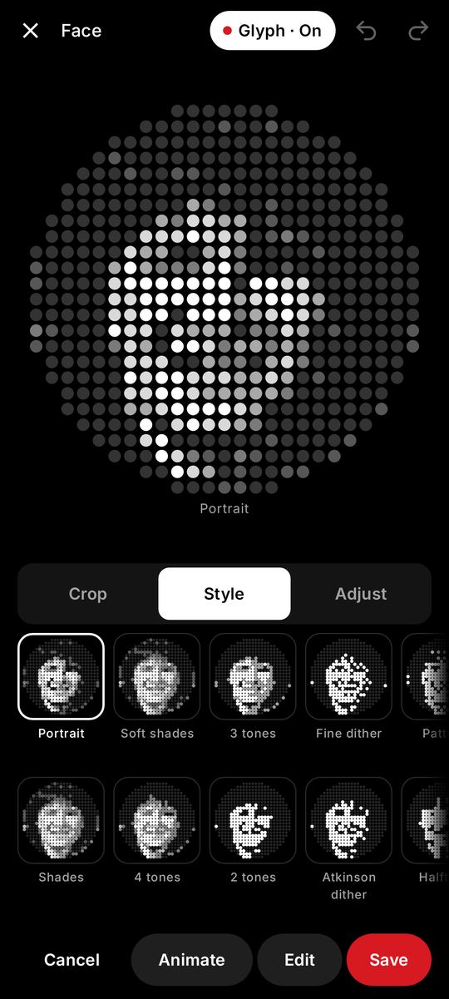

This turns a photo into dots. It uses the full-quality photo, fixes its rotation, and judges the light only inside the round Glyph.

1. Tap **+ New**, then **From a photo, GIF or file**. Choose **Choose photos or a file**, or **Take a photo** (it uses the camera without asking for camera permission).
2. The screen shows a big preview with the round Glyph shape. At the bottom are tabs: **Crop**, **Style**, **Adjust**, and **Frames** when you chose several photos.
3. **Crop**: pinch and drag to frame it. **Rotate**, **Mirror**, **Flip**, **Face** (focus on the face) and **Fill** or **Fit** (the whole photo inside the circle). **Zoom** has a **Reset**.
4. **Style**: tap a thumbnail. The choices are **Shades**, **Soft shades**, **4 tones**, **3 tones**, **2 tones**, **Fine dither**, **Atkinson dither**, **Pattern**, **Halftone**, **Outline**, **Outline + fill**, **Silhouette** and **Pop**. When a face is found, **Portrait** comes first.
5. **Adjust**: **Brightness**, **Contrast**, **Midtones**, **Detail** (sharpens edges and small shapes), **Shades**, **Threshold**, **Background** (darkens what is round the subject) and **Invert**. Each has **Reset**. These settings are saved with the design, so you can change them later.
6. Use **Undo** and **Redo** at the top and the **Glyph · On** button to see it on the real Glyph.
7. At the bottom, tap **Save** to finish, **Edit** to open it in the editor and touch up dots, or **Cancel**.

**Animate** makes one photo move. Tap **Animate** and choose **Zoom**, **Pan**, **Fade in**, **Reveal**, **Pulse** or **Glitch**. Set **Frames** and **Each frame**, then tap **Open in editor**.

**Several photos to frames**: pick more than one photo (or one GIF or video). Each photo becomes a frame. Use the **Frames** tab to move frames (**Move right**), or remove them. While you edit a design in the editor, **More > Insert: a design or photo...** can add a photo as frame, or its frames after the current frame.

Editing a photo design: in the editor use **Fill**, the **Brighten** and **Dim** brushes, **Replace shade**, and **Trace photo** to touch it up.

### Text and text animations

  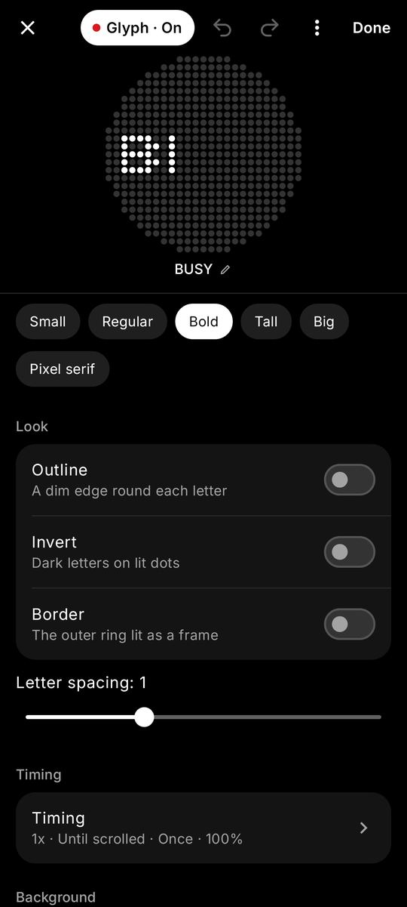

1. Tap **+ New**, then **Text**.
2. Type your words (up to 60 letters). Tap **Symbols** for hearts, stars, arrows, food, a car and more.
3. Pick a **Style**. Each has a live preview. Here are the styles:

| Style | What it does |
|---|---|
| **Scroll** | Slides across. |
| **Typewriter** | Types one letter at a time. |
| **Letter by letter** | One big letter at a time. |
| **Word by word** | One word at a time. |
| **Flash** | Blinks on and off. |
| **Fade** | Fades in and out. |
| **Cursor** | Types, then a blinking cursor. |
| **Bounce** | Drops in and bounces. |
| **Wave** | Scrolls on a wave. |
| **Rain** | Dots fall into place. |
| **Assemble** | Dots fly together. |
| **Glitch** | Shakes and flickers. |
| **Zoom** | Grows from the middle. |
| **Countdown** | Counts down, then shows it. |
| **Marquee border** | Lights run round the edge. |
| **Spotlight** | A bright spot sweeps over. |
| **Fit** | Still, as big as fits. |

4. Pick a **Direction**: **Left**, **Right**, **Up**, **Down**, **Back and forth** or **Around the ring**.
5. Pick a **Font**: **Small**, **Regular**, **Bold**, **Tall**, **Big** or **Pixel serif**.
6. Under **Look**: **Outline**, **Invert**, **Border**, **Letter spacing**, and **Pause at the ends**.
7. Under **Timing**, tap the row to open the [On the Glyph controls](#8-the-on-the-glyph-controls).
8. Under **Background**, you can add a glyph, one of your designs or a photo behind the words, choose its **Effect** and the **Text position**.
9. Tap **Done**.

The three dots offer **Edit as dots** (turns the text into frames you can draw on), **Rename**, **Share...**, **Duplicate design** and **Delete design**.

### Glyph ringtones from a song

  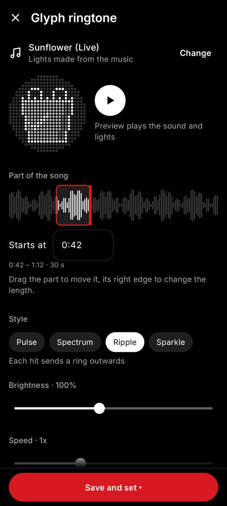

A Glyph ringtone is a ringtone whose lights move with the sound. The lights play on the back of the phone while it rings. For this, Nothing's Glyph ringtone setting must be on.

1. Tap **+ New**, then **Glyph ringtone**. Pick a song from your phone. DotForge shows **Finding the beat...** while it reads the song.
2. Tap the play button to preview. The sound plays, and the lights show on screen and on the Glyph. (Flip your phone over, because the lights are on the back.)
3. Under **Part of the song**, drag the box to choose which part to use. Drag its right edge to make it longer or shorter, up to 40 seconds. You can also type **Starts at**.
4. Pick a **Style**: **Pulse**, **Spectrum**, **Ripple** or **Sparkle**.
5. Adjust **Brightness**, **Speed**, and **Lights earlier / later** if the lights are not in time with the sound.
6. Tap **Edit lights** for a timeline of every light, if you want fine changes.
7. Give it a **Name**.
8. Tap **Save and set**. Choose **Ringtone**, **Notification**, **Alarm** or **For a contact...**.

Android may ask you to allow DotForge to change system settings (to set ringtones) or to edit contacts (for a contact's ringtone). Say yes only if you want that.

If you pick a Glyph ringtone file from a Phone (3), the lights are kept as they are. If it came from another Nothing phone, DotForge converts it and lets you choose how the lights sit on the Glyph.

Ringtones appear in **My ringtones** in Studio. Tap one to play it, or tap **Set as**. Touch and hold to delete.

---

## 7. Library

  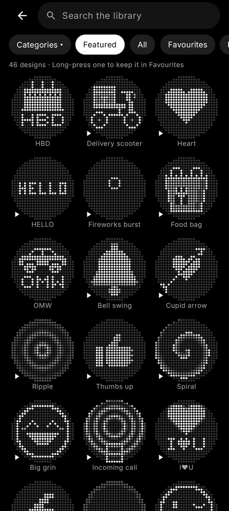
  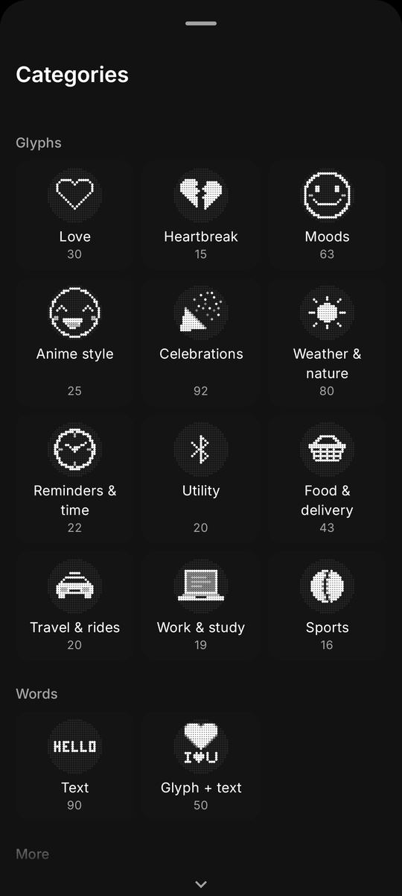

### What it does

The Library holds hundreds of ready-made designs (884 at the time of writing): still glyphs, animations, words, and glyph-plus-text. It opens from **Studio > + New > From the library**. The same picker also appears whenever you choose a glyph for an app, a person or a toy, so you always see the same thing.

### How to use it

1. Open the Library. At the top there is a search box, **Search the library**.
2. Under it are chips: **Categories**, **Featured**, **All**, **Favourites** and **Recently used**.
3. Tap **Categories** to open the list. Each category shows a picture and how many designs it has.
4. Tap a design. A sheet shows a big preview. Buttons:
   - **Try on Glyph** (it changes to **Stop on Glyph** while it plays).
   - **Use for...** to pick where it should show.
   - **Edit a copy** to open it in the editor (or the Text screen for text). Your copy is saved, and the original stays.
   - **Add to Favourites** (or **Remove from Favourites**).
5. You can also touch and hold any design to add it to **Favourites**.

Search finds things by name and by related words. For example "heart" finds all the hearts.

### The categories

**Glyphs**: Love, Heartbreak, Moods, Anime style, Celebrations, Weather & nature, Reminders & time, Utility, Food & delivery, Travel & rides, Work & study and Sports.

**Words**: **Text** (about 90 ready-made words, like greetings, love, status such as BUSY, reactions, celebrations and useful phrases) and **Glyph + text** (about 50 designs).

**More**: other groups such as Loaders, Music, Games, Abstract, Animals, Symbols and Stories & art.

The counts are shown on each tile and can change as the app grows.

### Glyph + text

A **Glyph + text** design is a picture with words in front, for example a heart with "I ♥ U", a cake with "HAPPY BDAY", or a car with "ON MY WAY". Each opens with its layers intact, so **Edit a copy** lets you change the words or the picture separately. See [Layers](#layers-a-background-plus-text).

### The text library

The **Text** category holds ready-made words in groups, such as Greetings and Love. Each one opens in the Text screen, so you can change the words, direction or style.

---

## 8. The "On the Glyph" controls

  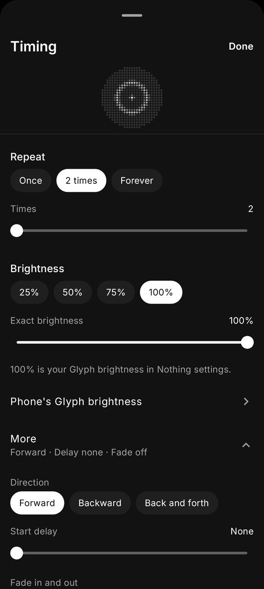

### What it does

Every design, and every place a design is used, has the same small panel that controls how it plays. It may be called **Timing** or **On the Glyph**. Changes preview straight away on the screen and, when **Glyph · On** is on, on the real Glyph.

### How to use it

1. Open **Timing** (in an editor), or tap **On the Glyph** (in a feature), or tap the timing words on an app's sheet.
2. Change what you want. Each control has quick chips and a slider for an exact value.
3. Tap **Done**.

### The four controls

| Control | What it means |
|---|---|
| **Show for** | How long it stays on. Chips like **5 s**, **10 s**, **30 s**, **Whole animation**, **Until scrolled** (for text) or **Until I check**. **Exact time** sets seconds precisely. With **Until I check**, **Remind me** shows it again after a rest. |
| **Speed** | **Slow**, **Normal** or **Fast** chips, or an exact speed slider. (For animations, 0.5x, 1x and 2x.) |
| **Repeat** | **Once**, a number of times (such as **2 times**), or **Forever**. |
| **Brightness** | **25%**, **50%**, **75%** or **100%**, or an exact value. The percentage is a share of your phone's own Glyph brightness. Tap **Phone's Glyph brightness** to change that setting in Nothing's settings. |

Under **More** you may also find **Direction** (**Forward**, **Backward**, **Back and forth**), **Start delay** and **Fade in and out**.

A short line at the top of the sheet tells you in plain words what will happen, for example "Plays 2 times at 1x (2.4 s), then turns off."

### Changing it for one place only

When you use a design for an app or a person, you can change its timing for that place without changing the design. The sheet shows "Changed for WhatsApp" with a **Reset** button. The choice **Design's own** means "use the speed and length the design was saved with".

---

## 9. Features

  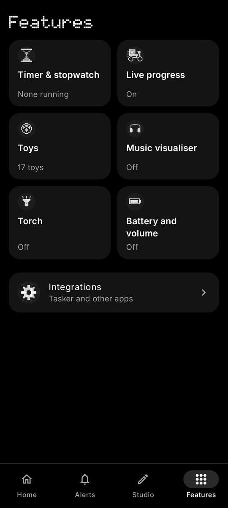

The Features tab is a grid of cards. Each card shows a name and one status line, such as "None running", "On", "17 toys" or "Off". Tap a card to open its page. Each page begins with a short line about what it does and has a **How it works** row at the bottom. A card that needs a permission shows **Needs access**.

The cards are: **Timer & stopwatch**, **Live progress**, **Toys**, **Music visualiser**, **Torch**, **Battery and volume**, and **Integrations**.

### Timer and stopwatch

  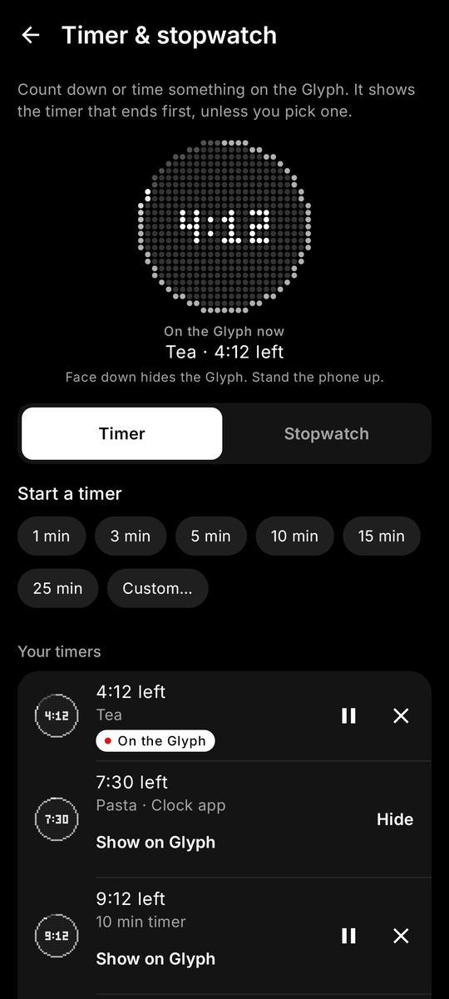

**What it does.** Counts down or times something on the Glyph. It runs inside DotForge (not as a toy), so it never stops after 30 seconds. It also shows as a Live Update in your status bar and on the lock screen.

**How to start a timer**

1. Open **Features > Timer & stopwatch**.
2. On the **Timer** tab, tap a time: **1 min**, **3 min**, **5 min**, **10 min**, **15 min**, **25 min**, or **Custom...** to type your own.
3. The Glyph shows the timer that ends first. To show a different one, tap **Show on Glyph** on that timer. Tap the pause button to pause, or the X to stop.

You can run several timers at once. They appear under **Your timers**.

**How to use the stopwatch**

1. Tap the **Stopwatch** tab and start it.
2. Tap **Lap** to record laps. The laps list shows each lap time and the total, and marks the **Slowest** and **Fastest**.
3. Tap **Pause** to pause.

**Options**

- **Timer style**: **Ring drain**, **Hourglass**, **Big digits**, **Pie**, **Dots** or **Orbit**. The stopwatch has its own: **Big digits**, **Ring fills**, **Pie** and **Comet**.
- **On the Glyph**: **When it ends** (**10 s**, **30 s**, **1 min** or **Until dismissed**) and **Finish speed**. After it ends it repeats every minute until you dismiss it. The last 10 seconds count down in big digits.
- **Also**: **Sound** (rings with your alarm sound), **Vibrate**, and **Show Clock app timers** (timers and stopwatch you start in the Clock app also show on the Glyph; this needs notification access).
- At the bottom, an **Allow** list shows things that make timers work better: notifications (so Time's up fills the screen), exact alarms (so a timer ends on the second) and notification access.

If the phone is face down, the Glyph is hidden. Stand the phone up to see it.

### Live progress

  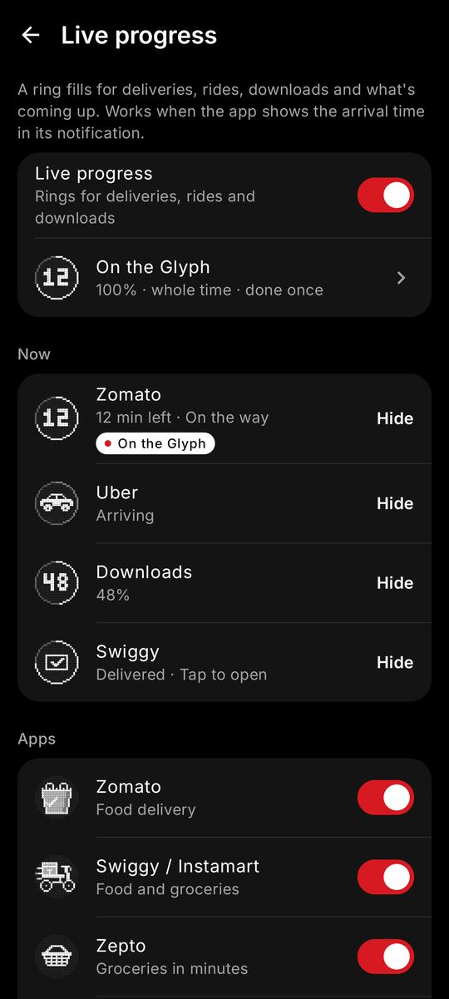

**What it does.** A ring fills for deliveries, rides, downloads and what is coming up. The middle of the ring shows the minutes left, or a picture of the stage. It pulses when arriving, and plays a "done" animation when it arrives.

It works with apps like **Zomato**, **Swiggy / Instamart**, **Blinkit**, **Zepto**, **BigBasket**, **Amazon**, **Flipkart**, **Uber**, **Ola**, **Rapido**, and any other app that shows a progress bar. It reads the progress bar, a countdown, or words like "arriving in 12 mins" and "ETA 7:45 PM" in the app's notification. If the app does not show the arrival time in its notification, DotForge cannot read it. Nothing leaves your phone. Apps you do not have installed are listed under "not on this phone".

**How to use it**

1. Open **Features > Live progress** (or use the **Live progress** tile on Home).
2. Turn on the main **Live progress** switch. Allow notification access if asked.
3. Under **Apps**, switch each app on or off.
4. Order something. The delivery appears under **Now**, with a red **On the Glyph** tag when it shows on the Glyph. Tap a row to open its app. Tap **Hide** to take it off the Glyph.

**Options** (tap **On the Glyph**)

- **Show the ring**: **Whole time** or **Last 10 min**, with an optional **10 s on each change**.
- **Repeat the done animation**: **Once**, **3 times** or **Until I check**.
- **Speed**, **Brightness**.
- **Middle shows**: **Minutes** (time left) or **Stage** (the order's stage).
- **Try it** plays a sample.

**Coming up**: rings fill before **Next calendar event** and **Next alarm**. Set **Off**, **5**, **10**, **15** or **30** minutes. For the calendar, DotForge needs Calendar access ("Calendar access is off, so the event ring can't show", with an **Allow** button).

### Toys

  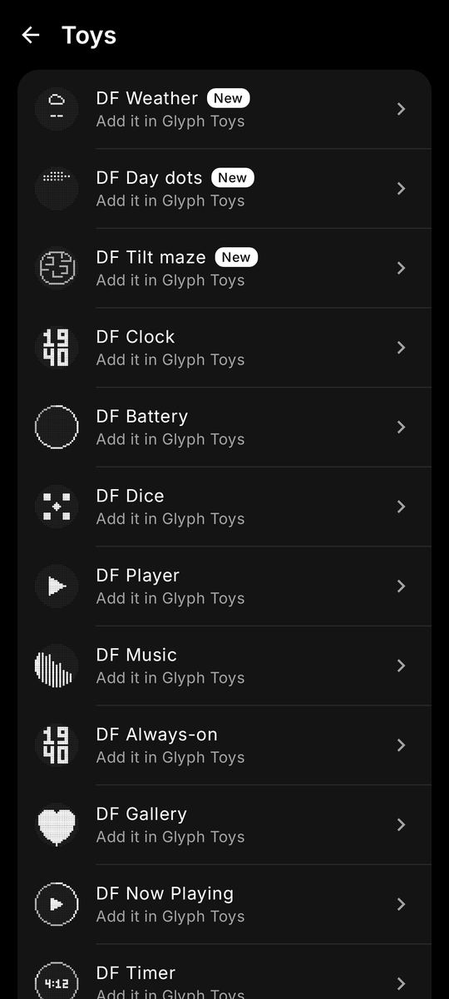

**What it does.** A toy is a small thing that lives on the Glyph: a clock, a game, the weather. You switch between toys by pressing the **Glyph Button** on the back of the phone. A long press does the toy's own special action.

**Important:** toys only appear when they are added in **Glyph Toys**, which is Nothing's own list. DotForge's toys do not appear in the Glyph Button list until you add them. Nothing also stops a toy after 30 seconds without a press.

**How to add a toy**

1. Open **Features > Toys**. You see the list of DotForge toys, each marked **Add**, **Not added** or **In Glyph Toys**.
2. Tap a toy to see what it does and its settings.
3. Tap **Add to Glyph Toys** (or **Add** in the list). Nothing's Glyph Toys screen opens.
4. Switch the toy on there.
5. Press the Glyph Button on the back to move to it.

**The toys**

| Toy | What it does |
|---|---|
| **DF Clock** | Big dot clock, works on the always-on screen. Long press: date. Choose a clock style (**Digital**, **Analog**, **Dot font**, **Binary**) and 12 or 24 hour. |
| **DF Battery** | Battery ring, animated while charging. Long press: percent. |
| **DF Dice** | Press the Glyph Button, or shake the phone, to roll. |
| **DF Player** | Loops a design you made. Long press: pause. Double press: restart. |
| **DF Music** | Bars, a ring pulse or a radial spectrum from what is playing. Long press: next look. |
| **DF Gallery** | Your favourite designs in turn. Press: next. Long press: pause. |
| **DF Always-on** | One always-on toy with the face you pick: clock and battery, gallery, moon or now playing. Long press: next face. |
| **DF Now Playing** | Play or pause and the track position. Press: play or pause. Long press: next track. Double press: previous. |
| **DF Timer** | Shows your DotForge timer. Press: pause or carry on. Long press: stop. |
| **DF Compass** | A compass needle. Long press: spirit level. |
| **DF Snake** | Snake. Press: turn right. Long press: turn left. |
| **DF Breathe** | Box breathing: press to start four slow breaths. |
| **DF Weather** | The sky and the temperature. Press: chance of rain. Long press: update. It needs rough location, or a place you type. |
| **DF Day dots** | One dot for every 10 minutes of screen time today. Needs Usage access. |
| **DF Tilt maze** | Tilt to roll the ball to the goal. Long press: start again. |
| **DF Moon** | Today's moon phase. Long press: days to the full moon. |
| **DF Speed** | Download speed now, on the ring and in numbers. |

At the bottom of the Toys page:

- **Get more toys**: toys from other makers, free. Each shows its version, size and licence. Tap **Install**. Android asks you to allow installing, and confirms each install. These are other people's apps, not made by DotForge.
- **Add the widget**: puts a design or the live Glyph on your home screen.

**The always-on screen.** Use the **Always-on** row on Home (**Change**) to choose the face the Glyph shows when the screen is off: **Clock**, **Gallery**, **Moon**, **Now playing**, or one of your designs or library favourites. It changes once a minute. You can also add the **Always-on face** tile to Android's Quick Settings.

### Music visualiser

  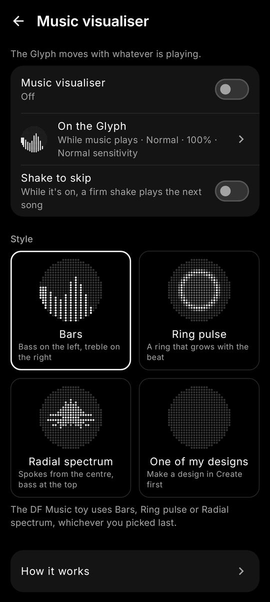

**What it does.** The Glyph moves with whatever music is playing, about 30 times a second. DotForge listens to the sound the phone plays. If Android will not share it (some apps block it), DotForge listens through the microphone and says so. Nothing is recorded or saved.

**How to use it**

1. Play music in any app.
2. Open **Features > Music visualiser** and turn on **Music visualiser**, or use the **Visualiser** tile on Home. Allow the microphone if asked.
3. Pick a **Style**: **Bars** (bass on the left, treble on the right), **Ring pulse** (a ring that grows with the beat), **Radial spectrum** (spokes from the centre) or **One of my designs**.

**Options**: tap **On the Glyph** for **Show for** (**While music plays** or **Until I turn it off**), **Smoothing** (**Smooth** glides down after a beat, **Snappy** drops at once) and **Sensitivity** and **Brightness**. **Shake to skip**: while it is on, a firm shake plays the next song.

Alerts, timers and the torch show over the visualiser, then it comes back. There is also a Quick Settings tile named **Music on Glyph**.

### Torch

  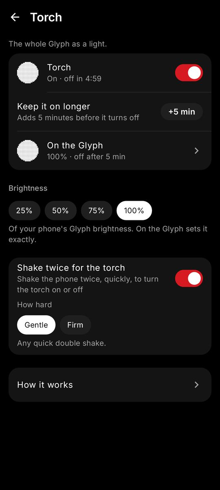

**What it does.** Lights every dot of the Glyph as a torch. It fades on, then turns itself off after the time you pick, so it cannot drain the battery by accident.

**How to use it**

1. Turn it on from **Home > Torch**, from **Features > Torch**, or from the **Glyph torch** tile in Quick Settings.
2. Tap **+5 min** under **Keep it on longer** to add time.
3. Tap **On the Glyph** to choose **Turns off after** (how long it stays on; **Never** keeps it on until you turn it off) and how quickly it fades on (**Slow**, **Normal** or **Quick**).

**Options**: **Brightness** (**25%**, **50%**, **75%**, **100%**, a share of your phone's own Glyph brightness). **Shake twice for the torch** (shake the phone twice, quickly, to turn the torch on or off), with **How hard**: **Gentle** or **Firm**.

A call shows over the torch. Nothing else does.

### Battery and volume (charging and volume lights)

  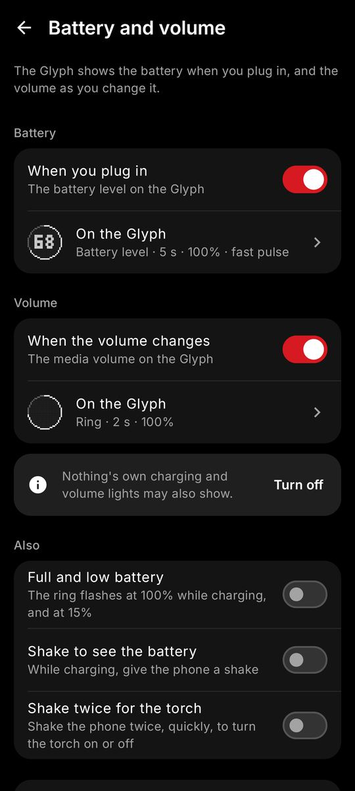

**What it does.** The Glyph shows the battery when you plug in, and the volume as you press the volume keys.

**How to use it**

1. Open **Features > Battery and volume** (or turn on the **Battery** tile on Home).
2. Under **Battery**, turn on **When you plug in**. Tap **On the Glyph** to pick the design: **Fill** (the ring fills up to the battery level), **Battery level** (the ring and the number) or one of your own designs. On a charger of 15 W or more it pulses twice.
3. Under **Volume**, turn on **When the volume changes**. The ring slides to the new level, or your design plays.
4. Under **Also**, switch on any extras: **Full and low battery** (the ring flashes at 100% while charging and at 15%), **Shake to see the battery** (while charging) and **Shake twice for the torch**.

Nothing's own charging and volume lights may also show. If you see a note about this, tap **Turn off** to switch off Nothing's. These lights work while DotForge is running, which notification access keeps going.

### Integrations (Tasker and other apps)

  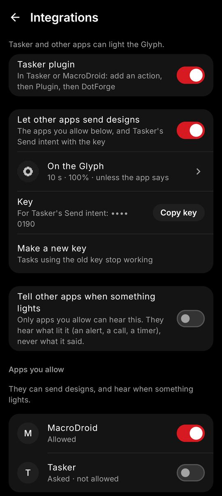

**What it does.** Lets other apps, like Tasker and MacroDroid, light the Glyph. This is an advanced feature. You do not need it for normal use.

**How to use it**

1. Open **Features > Integrations**.
2. **Tasker plugin**: turn it on. In Tasker or MacroDroid, add an action, choose **Plugin**, then **DotForge**, and pick a design.
3. **Let other apps send designs**: turn it on so apps you allow can send a design name or a short text. DotForge shows it like an alert, for example Heart for 10 seconds, or 3 times. Under **Apps you allow**, switch on each app you trust. An app appears there after its first attempt ("Asked · not allowed").
4. **Key**: for Tasker's Send intent, tap **Copy key**. Tap **Make a new key** if the key got out. Apps using the old key stop working.
5. **Tell other apps when something lights**: optional. Apps you allow hear what kind of thing lit the Glyph (an alert, a call, a timer), never what it said or who sent it.

**On the Glyph** sets the default time, brightness and speed for these. **For app makers** lists the actions for people who write apps.

---

## 10. Settings, permissions, backup and restore

  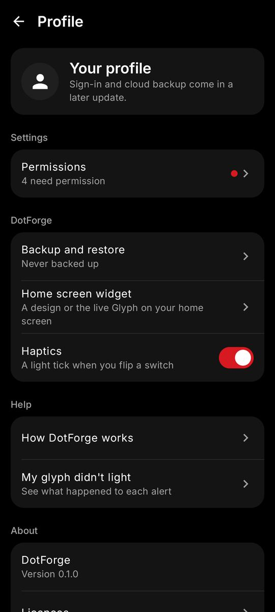
  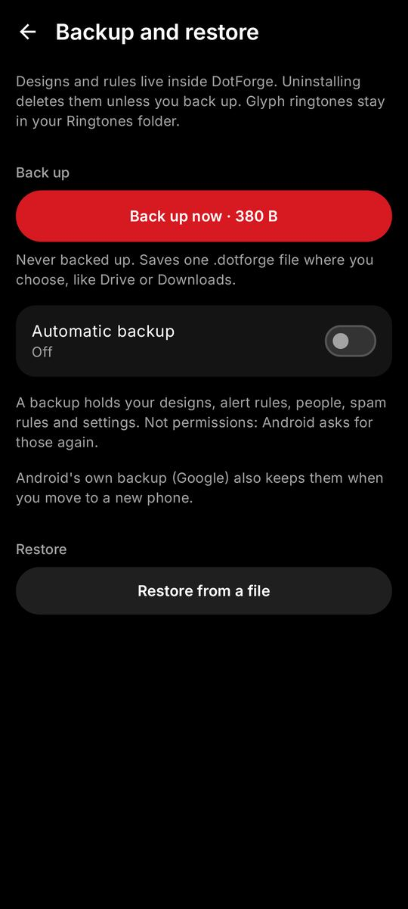

### Profile

Tap the round person icon at the top right of Home. A card says "Your profile. Sign-in and cloud backup come in a later update." Under it are:

- **Permissions**: shows how many need your attention. Tap it to see the full list.
- **Backup and restore**.
- **Home screen widget**.
- **Haptics**: a light tick when you flip a switch.
- **How DotForge works**: a short help sheet.
- **My glyph didn't light**: opens History so you can see what happened to each alert.
- **About**: the app version, **Licences**, and **Diagnostics** (logs to share if something breaks).

### Permissions

The **Permissions** page lists each one with a green "Allowed" or a red "Needed" or "Optional". Tap any row to open Android's page for it.

**Needed for alerts**

| Permission | Why |
|---|---|
| **Notification access** | Lights the Glyph for your apps, caller names and live progress. |
| **Call screening** | Blocks spam calls and shows who is calling. |
| **Contacts** | Names for people and callers. |
| **Keep running** | So the Glyph still lights when the screen is off. |

**Only for some features**

| Permission | Why |
|---|---|
| **Microphone** | Only for the Music visualiser. |
| **Notifications** | The timer on the lock screen, and quiet copies of silenced messages. |
| **Modify system settings** | Only to set Glyph ringtones. |
| **Location** | Only for DF Weather's "where I am". |
| **Usage access** | Only for DF Day dots' screen time. |

Calendar access (for the ring before calendar events) and the permission to install other toys are asked only when you use those features.

### Backup and restore

A backup file holds your designs (with their photos), alert rules, people, spam rules and settings. It does not hold permissions. Android asks for those again. Glyph ringtones stay in your Ringtones folder. If you uninstall DotForge without a backup, your designs and rules are deleted.

**To back up**

1. Open **Profile > Backup and restore**.
2. Tap **Back up now**. Choose where to save the `.dotforge` file, for example Downloads or Google Drive.
3. Optional: turn on **Automatic backup** to save a copy every week to a folder you choose.

**To restore**

1. Open **Profile > Backup and restore** (or tap **Restore from a backup** on the welcome screen).
2. Tap **Restore from a file** and choose your `.dotforge` file.
3. Choose **Add to what's here** (keeps everything on this phone and adds what is new) or **Replace everything** (replaces your designs, rules and settings with the backup's, and cannot be undone).
4. Tap **Restore**. DotForge restarts when it is done.

Android's own Google backup also keeps your data when you move to a new phone.

---

## 11. Troubleshooting and FAQ

**The caller's name does not show while the phone is ringing.**
Nothing's ringtone lights cover DotForge's. Set Nothing's Glyph ringtone lights to **Sound only**. In DotForge, open **Alerts > Apps > Phone calls** and tap **Change setting**. Also check that **Call screening** is allowed and **Phone calls** is on.

**The Glyph shows nothing for my alerts.**
Check these, in order:

1. Is the phone a Phone (3), and is the Glyph on in Nothing's settings? Home says **The Glyph is off in Settings** if not.
2. Is **Notification access** allowed? Look for a banner on Home or the Permissions page.
3. Is **Keep running** allowed? Without it Android may stop DotForge when the screen is off.
4. Is **Alerts** paused on Home, or is **Quiet** on? Check the Alerts and Quiet tiles.
5. Is the phone face down or in a pocket? Nothing hides lights from apps then. Turn the phone face up.
6. Is the app's row switched on in **Alerts > Apps**?
7. Is another light using the Glyph, like the torch or a toy? Home says so.
8. Open **Alerts > History** to see why that alert was skipped, for example "Skipped · Quiet" or "Skipped · phone face down".
9. If Android says access is blocked after installing from a file, use **Open App info**, then the three dots, then **Allow restricted settings**.

**I see two different lights for one alert.**
That is Nothing's own light plus DotForge's. Tap **Fix** next to "Stop double lights" on Home (or on the app's row) and set that app to **Sound only** in Nothing's Glyph settings.

**A toy is not in the Glyph Button list.**
Toys must be added in **Glyph Toys**, which is Nothing's own list. Open **Features > Toys**, tap the toy, and tap **Add to Glyph Toys**. Then switch it on there. DotForge cannot add it for you.

**The Glyph turned off after 30 seconds.**
That is Nothing's own rule for toys: it rests the Glyph after 30 seconds without a press. Press the Glyph Button to wake it. Timers, live progress, alerts and the torch run inside DotForge, so they are not stopped by this.

**My timer or progress ring is hidden.**
A face-down phone hides the Glyph. Stand it up. Also check that Nothing's own light is not using the Glyph.

**Live progress does not show my delivery.**
It only works when the app puts the arrival time or progress in its notification. Check that the app's row is switched on under **Features > Live progress > Apps**, and that notification access is on.

**The music visualiser says it uses the microphone.**
Android did not share that app's sound, so DotForge listens through the microphone instead. Nothing is saved.

**The photo cannot be read.**
Try another photo. For GIFs and videos, the message says "This GIF can't be read. Try another file."

**I blocked something by mistake.**
Open **Alerts > History**, tap the entry and choose **Not spam**. It is added to **Numbers and senders you let through**.

**Spam calls are not being blocked.**
Home and Alerts say "Spam calls aren't being blocked" when DotForge is not your call screening app. Tap **Fix** and allow Call screening.

**I removed something by accident.**
Most removals show a bar with **Undo** for a few seconds. Tap it.

**Can I use it on another phone?**
You can draw designs and set up blocking, and previews play on screen, but the Glyph lights need a Phone (3).

**Where did the old tabs and screens go?**
The app was redesigned. The old screens are kept for now under Profile, in the hidden **Developer** section (tap the version row seven times).

---

## 12. Privacy

DotForge runs on your phone. There is no account, no ads and no tracking.

**What stays on the phone**

- Your notifications, calls, contacts, messages and what lit the Glyph. They are read on the phone to decide what to show, and are never sent anywhere.
- Your designs, photos, rules, people, spam rules and settings.
- The spam checks. DotForge keeps the community spam list on your phone and checks numbers there.
- Music for the visualiser. It is turned into light and never recorded.
- Tasker and other apps: only apps you allow can use DotForge, and they hear only what kind of thing lit the Glyph, never what it said.

**What leaves the phone**

- **The Weather place.** The DF Weather toy sends only the place (your rough location or the place you typed) to Open-Meteo, a free weather service, to get the weather. Nothing else is sent.

**Downloads that only fetch files.** A few features download public files when you use them: the community spam list (weekly), the list of Glyph ringtones in **Get more ringtones**, and the list of toys in **Get more toys**. These only ask for the files. Nothing of yours is sent in them.

Your backup file is saved only where you choose.
